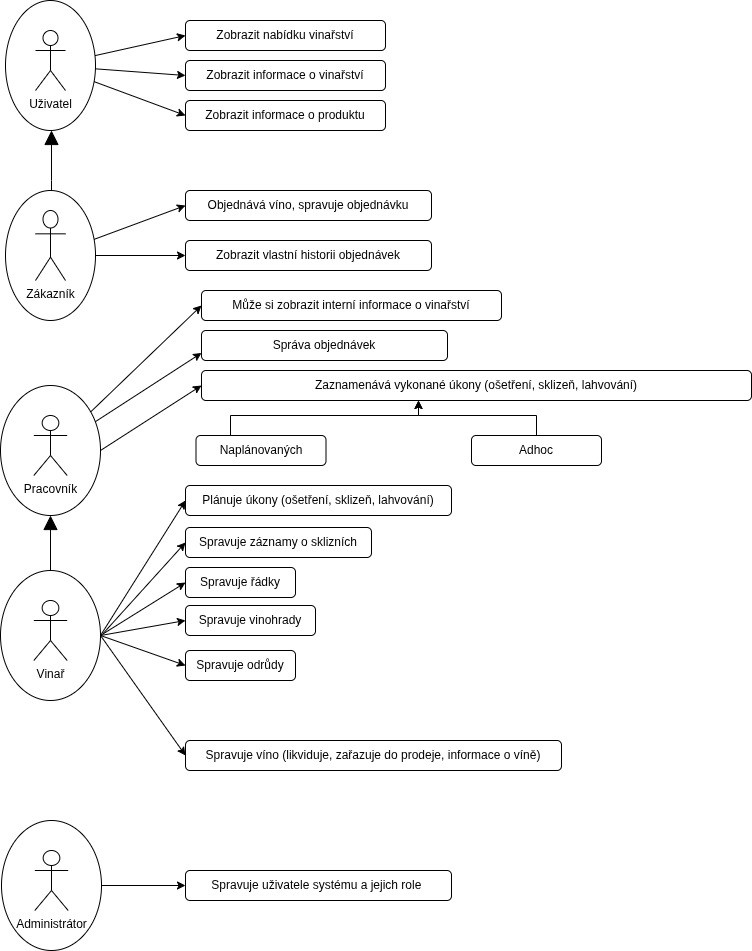
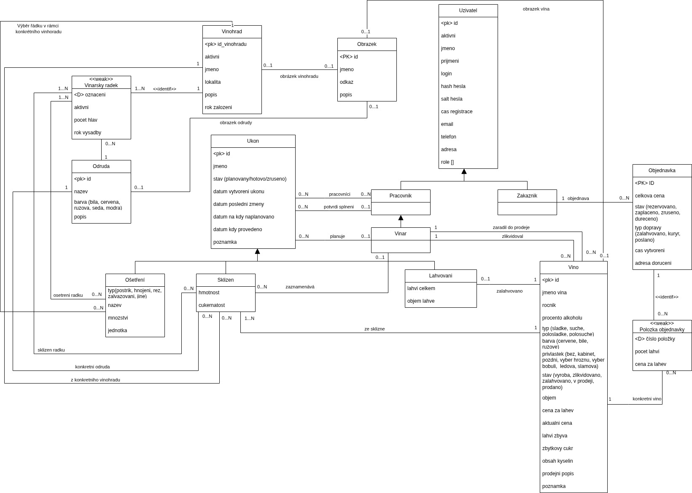

# Winery Information System

A web information system for a winery. It covers the whole path from the vineyard to the customer: vineyards and grape varieties, harvests, vineyard treatments, wine production, bottling, and an e-shop with order management.

Team project for the **IIS** course (Information Systems) at the Faculty of Information Technology, Brno University of Technology (BUT FIT), 2025.

**[Video demo on YouTube](https://www.youtube.com/watch?v=6O83srVxGUU)**

## Features

**Public part / e-shop**
- Home page with information about the winery
- Wine shop with wine detail pages, shopping cart and a simple payment gateway
- Registration, login, user profile and order history

**Internal information system** (for employees)
- **Vineyards:** vineyards, vine rows and grape varieties
- **Tasks:** planning and recording harvests, treatments (spraying, fertilizing, pruning, weeding, …) and bottling
- **Wine production:** making wine from one or more harvests (cuvée), bottling, putting wine on sale
- **Orders:** order management for the shop
- **Users:** user and role management by the administrator
- **Images:** uploading and managing pictures of wines, vineyards and varieties
- E-mail delivery of new and reset passwords

## Design notes

- **Multiple roles per user** (Admin, Winemaker, Worker, Customer), so for example a winemaker can buy wine without a second account.
- **Wine production is a sequence of tasks:** plan harvest → record harvest (a worker) → confirm harvest with sugar content and weight (a winemaker) → make wine → plan and record bottling → put on sale.
- **Soft delete:** most entities are marked as inactive instead of being deleted, so the history stays consistent (orders still point to wines made from harvests of vineyards that no longer exist).

## Tech stack

- **PHP 8.3** with the **Nette 3.2** framework (MVC presenters, repositories, Latte templates)
- **MySQL**
- **Bootstrap 5.3**, Font Awesome
- **Docker Compose** (Apache + PHP, MySQL, phpMyAdmin)
- PHPStan and PHP_CodeSniffer for static analysis and code style

## Running locally

Requirements: Docker with Docker Compose.

```sh
docker compose up --build
```

The database is created and filled with sample data automatically.

| Service | URL |
|---|---|
| Application | http://localhost:8080 |
| phpMyAdmin | http://localhost:8001 |

Optional: to send e-mails (new and reset passwords), fill in the SMTP settings in `config/common.neon`.

### Test accounts

All test accounts use the password `111111111`.

| Login | Roles |
|---|---|
| `andrej` | Admin, Winemaker, Worker, Customer |
| `navratil` | Customer, Worker, Winemaker |
| `pecinka` | Customer, Worker |
| `tabula` | Worker, Customer |
| `bohumil` | Customer |

### Code quality

```sh
make check    # PHPStan + PHP_CodeSniffer
make cs-fix   # automatic code style fixes
```

## Project structure

```
app/
├── Model/          domain models and repositories (Wine, Task, Orders, Vineyard, Security, …)
└── Presentation/   presenters and Latte templates
    ├── Home, Shop, Wine, Cart, Payment, OrderHistory, Profile, Sign   public part
    └── IS/         internal system: Dashboard, Orders, Tasks, Users,
                    Vineyards, Wine, WineVarieties
config/             Nette configuration
db/                 database schema and sample data (loaded by Docker)
docs/               diagrams
www/                public web root (index.php, assets, uploads)
```

## Diagrams

**Use case diagram**



**ER diagram**



## Authors

| Author | Main parts |
|---|---|
| **Martin Zůbek** ([@MiroSatona](https://github.com/MiroSatona)) | profiles, user management, home page, task management, wine management |
| **Otakar Kočí** ([@Otas02CZ](https://github.com/Otas02CZ)) | application structure, login and registration, grape varieties, vineyards, wine |
| **Martin Mendl** ([@Mr-Annonym](https://github.com/Mr-Annonym)) | shop, order history, cart, order management, task management, wine management |

The application and database design and the documentation were done together.

## Image credits

The sample pictures of wines, vineyards and grape varieties come from the internet. Their sources are listed in [images.md](images.md).

## License

© 2025 Martin Zůbek, Otakar Kočí, Martin Mendl. All rights reserved.

The code is public for portfolio and reference purposes only. Using, copying or modifying it requires written permission from the authors. See [LICENSE](LICENSE).
